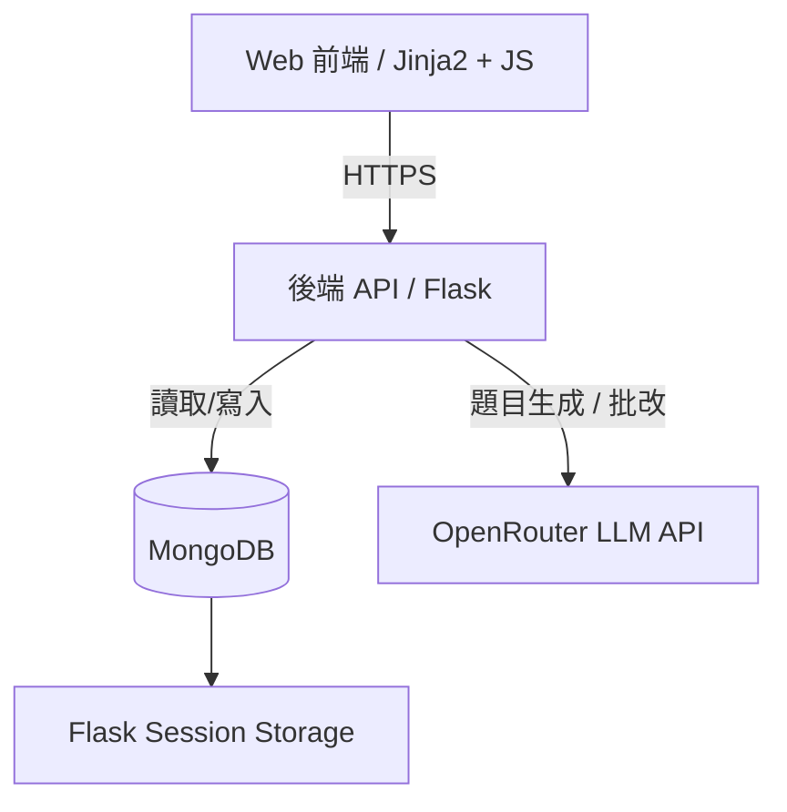
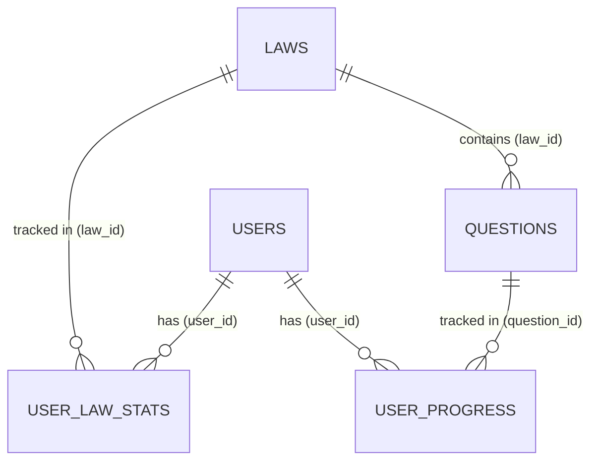

# 專利師考試 AI 刷題助手

**作者:** Johnny Chang  
**日期:** 2026-05-22  
**狀態:** 開發中 (In Progress)  
**GitHub URL:** https://github.com/johnny890122/patent_act  
**生產環境 URL:** https://patent-act-15774ac83829.herokuapp.com/

---

## 1. 執行摘要 (Executive Summary)
本專案是一個由 AI 驅動的測驗小幫手，旨在幫助使用者學習並精通各項台灣法規。目前已支援專利法、專利審查基準、訴願法以及行政訴訟法。透過整合 OpenRouter 的 LLM (大型語言模型)，本應用程式能動態生成多樣化的測驗題目、利用 AI 自動批改簡答題並回饋，同時支援中英文 (zh-TW 與 EN)，並為多位使用者分別記錄個人化進度。

## 2. 目標與非目標 (Goals & Non-Goals)

### 目標
*   **預計達成的項目：** 使用 Flask 與 MongoDB 建立一個穩定且具擴展性的網頁應用程式。
*   支援多使用者驗證與個人化追蹤（包含連續答對次數、星號標記題目、統計數據)。
*   整合具推理能力的 LLM 來產生高品質題目（選擇題與簡答題），並使用快速的 LLM 進行即時批改。
*   支援多種法規，並能透過 Session 無縫切換。
*   實作資料隔離（Data Isolation），讓使用者只能與自己的進度或星號標記互動。

### 非目標
*   **目前明確「不會」建立的項目：** 我們目前不會建立原生的 iOS/Android 應用程式；目前的開發重心完全放在響應式網頁介面上。
*   全面的 UI 多國語系化（例如將選單導覽改為英文）不在範圍內；目前僅法規與題目內容支援 i18n，UI 介面仍維持繁體中文。
*   不會實作超越基本使用者/管理員權限的複雜 RBAC (角色基礎存取控制)。

---

## 3. 系統架構 (System Architecture)

本專案架構為一個 Flask 網頁應用程式，並與外部 LLM 平台及 NoSQL 資料庫進行互動。

### 高階架構圖

### 元件分析
| 元件 | 技術棧 | 職責 / 角色 |
| :--- | :--- | :--- |
| **前端** | Jinja2 Templates, Vanilla JS, CSS | 使用者介面、測驗互動、儀表板渲染。 |
| **後端** | Python, Flask, Gunicorn | 路由處理 (驗證、測驗、法規)，建立 Session 狀態管理。 |
| **資料庫** | MongoDB | 持久化儲存使用者、法規、題目以及個人化進度。 |
| **AI 整合** | OpenRouter | 題目生成 (`question_gen.py`)、批改 (`grader.py`)、翻譯 (`translator.py`)。 |

---

## 4. 資料模型與 Schema (Data Model & Schema)

所有的 Schema 皆在應用程式層透過 Python `dataclasses` 來強制規範。

### 核心實體與關聯性 (Core Entities & Data Relations)

本系統資料庫（MongoDB）具有以下核心集合（Collections）以及它們之間的關聯性：

**資料關聯性 (Data Relations):**

**users (使用者)**

| 欄位 (Field) | 型別 (Type) | 描述 (Description) |
| --- | --- | --- |
| `email` | `str` | Google 登入識別碼，小寫儲存，唯一 |
| `username` | `str` | 唯一的使用者標籤（非登入憑證） |
| `display_name` | `str` | 畫面顯示名稱 |
| `created_at` | `datetime` | 帳號建立時間 |
| `last_login` | `datetime` | 最後登入時間 (選填) |

**laws (法規 - 支援多法規與 i18n)**

| 欄位 (Field) | 型別 (Type) | 描述 (Description) |
| --- | --- | --- |
| `article_number` | `str` | 法條條號字串 (如: "第 1 條") |
| `content` | `str` | 法條完整內容 |
| `chapter` | `str` | 該法條所屬章節 |
| `type` | `str` | 法規類型（如: `"patent-act"`, `"administrative-appeal"`）|
| `article_number_int`| `int` | 法條數字（用於精確排序） |
| `lang` | `str` | 語言標籤 (`zh-TW` 或 `en`) |

**questions (題目)**

| 欄位 (Field) | 型別 (Type) | 描述 (Description) |
| --- | --- | --- |
| `law_id` | `str` | 關聯至 laws 表的識別碼 (Foreign Key) |
| `type` | `str` | 題目類型 (`"MCQ"` 或 `"ShortAnswer"`) |
| `content` | `str` | 題目內容 |
| `correct_answer`| `str` | 正確解答 |
| `ai_explanation`| `str` | AI 生成的詳解 |
| `lang` | `str` | 語言標籤 (`zh-TW` 或 `en`) |
| `options` | `List[str]` | 多選題的選項 (選填) |
| `is_deleted` | `bool` | 是否已刪除 (軟刪除) |
| `base_question_id`| `str`| 連結不同語言版本的翻譯來源識別 (選填) |

**user_progress (使用者進度)**
*複合唯一索引 (Composite unique index): `(user_id, question_id)`*

| 欄位 (Field) | 型別 (Type) | 描述 (Description) |
| --- | --- | --- |
| `user_id` | `str` | 關聯至 users 表的外鍵 |
| `question_id` | `str` | 關聯至 questions 表的外鍵 |
| `correct_streak`| `int` | 連續答對次數 |
| `needs_review` | `bool` | 是否需要複習 |
| `last_score` | `float` | 最後一次測驗得分 |
| `is_appealed` | `bool` | 是否曾遭使用者申訴 |

**user_law_stats (使用者法規統計)**
*複合唯一索引: `(user_id, law_id)`*

| 欄位 (Field) | 型別 (Type) | 描述 (Description) |
| --- | --- | --- |
| `user_id` | `str` | 關聯至 users 表的外鍵 |
| `law_id` | `str` | 關聯至 laws 表的外鍵 |
| `total_score` | `float` | 該法規測驗累計總分 |
| `attempt_count` | `int` | 該法規累計測驗次數 |
| `avg_score` | `float` | 該法規測驗平均得分 |

*(其他還有針對 `user_law_stars`, `user_question_stars`, 以及 `i18n_mapping` 的追蹤模型)*

---

## 5. 核心技術決策與取捨 (Key Technical Decisions & Trade-offs)

*   **決策 1: 選用 MongoDB 而非關聯式資料庫 (PostgreSQL/MySQL)**
    *   *原因:* 法條內容與生成的題目規模無法預測，且包含豐富的巢狀結構（例如選項陣列）。MongoDB 能輕鬆處理這種 Schema 的靈活性。
    *   *取捨:* 我們必須在應用程式層（使用 Python dataclasses）手動強制執行 Schema 規則，並在過濾使用者忽略的法規進度時，需手動執行 Join 邏輯或二次查詢。
*   **決策 2: 共用內容 vs 個人化進度**
    *   *原因:* 法條與生成的題目為全域資料，由所有使用者共用以最佳化生成成本並減少資料重複。只有進度與星號標記會個別針對使用者追蹤。
    *   *取捨:* 我們需要在特定使用者的集合中建立複合唯一索引（例如 `(user_id, law_id)`），這讓部分讀取情境變得複雜。
*   **決策 3: 同步的測前檢查 (Pre-flight Check) vs 阻塞式生成**
    *   *原因:* 為了避免使用者遭遇過長的載入畫面，系統會在建立新測驗前先驗證題庫庫存。如果可用題數小於要求的數量 (`< n`)，前端會直接顯示警告供選擇，而不是在伺服器端阻塞同步生成。
    *   *取捨:* 建立 Session 前會些微增加 Client 端與 Server 端之間的通訊次數。

---

## 6. 安全性與隱私 (Security & Privacy)

*   **身分驗證 (Authentication):** 利用 Flask 內建的 Session 管理機制搭配已簽章的 Cookies 保護，經由 `@login_required` 裝飾器來保護需要驗證的路由。
*   **資料保護 (Data Protection):** 資料範圍的隔離直接在領域邏輯 (Domain logic) 內被強制執行，每個獲取資料的路由都會確實核對查詢目標與當下 `session['user_id']` 的相符性。
*   **環境變數 (Environment Variables):** 開發環境下機密資訊安全地存放在 `.env` 中（經由 `python-dotenv` 載入），生產環境則存放在 Heroku 的 Config vars 中。所有金鑰與設定均不會提交進入版本控制系統。

---

## 7. 基礎設施與部署策略 (Infrastructure & Deployment Strategy)

*   **託管服務 (Hosting):** 部署於 Heroku 平台（底層使用 `gunicorn` 作為 WSGI HTTP Server）。線上實際網站: https://patent-act-15774ac83829.herokuapp.com/
*   **資料庫 (Database):** MongoDB Atlas (雲端託管的 NoSQL 叢集)。
*   **LLM API:** OpenRouter 提供呼叫具推論能力的高階模型（產生題目）與快速反應模型（負責批改）。
*   **CI/CD:** 藉由整合套件 (`pytest`, `flake8`)，未來可進行持續測試與程式碼檢查。

---

## 8. 里程碑與實作計畫 (Milestones & Implementation Plan)

*   [x] **Phase 1:** 核心機制 MVP（支援單一使用者使用的 LLM 批改及法規題目生成）。
*   [x] **Phase 2:** 多使用者架構建立與身分驗證設置。
*   [x] **Phase 3:** 雙語多國語系 (i18n) 支援與多法規架構相容（專利法、審查基準、訴願法等）。
*   [ ] **Phase 4:** 擴展統計數據報表、提供法規間切換介面 (Law Type Switcher UI) 及管理員後台。
*   [ ] **Phase 5:** 體驗打磨 (Polishing)、效能最佳化，以及準備轉為開源發佈狀態。
