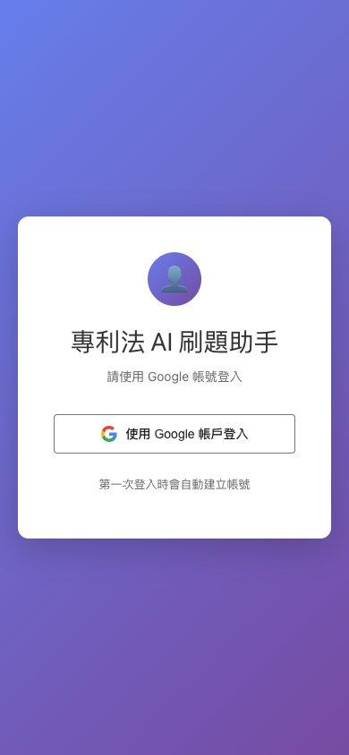
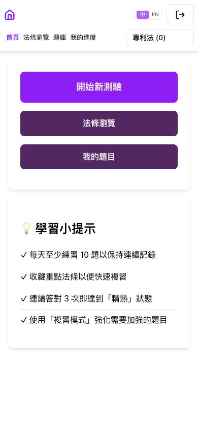
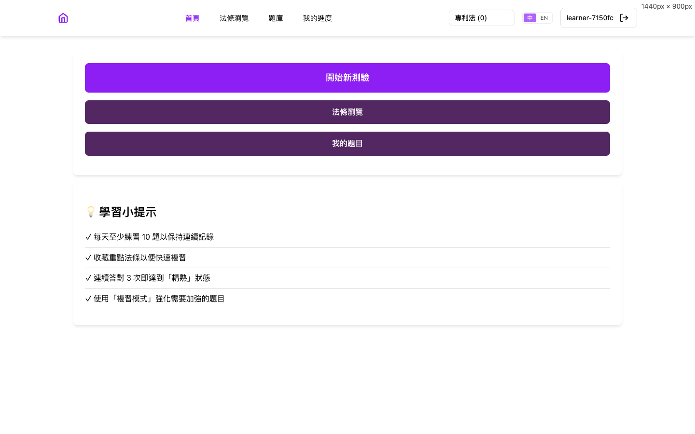
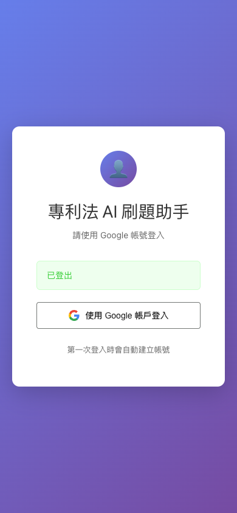
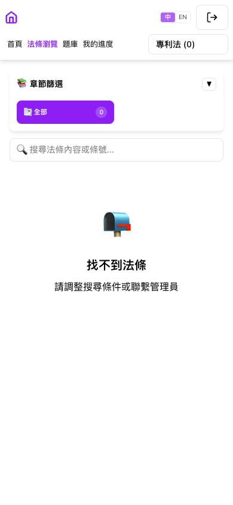
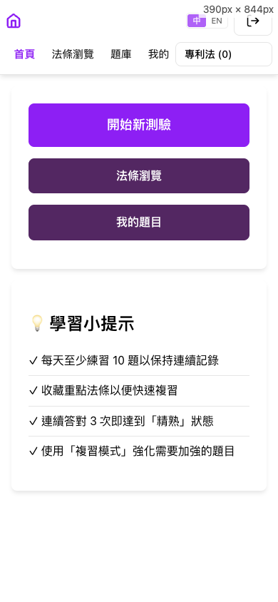
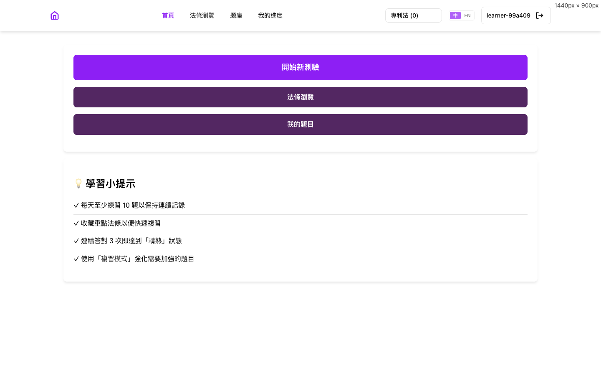

# Report: Google sign-in with self-signup

- **Ticket:** `LP-0002-01`, listed in [docs/issues/](../../issues/README.md).
- **PRD:** [LP-0002-01-google-sign-in](../../prd/LP-0002-01-google-sign-in.md)
- **Changelog:** [2026-10-16-google-sign-in](../../changelog/2026-10-16-google-sign-in.md),
  and [2026-10-17-account-chooser-after-logout](../../changelog/2026-10-17-account-chooser-after-logout.md)
  for the account chooser seen in step 4.
- **Verified at:** commit `3c1dcd8` + working tree. The working tree holds
  the removal of console account creation.
- **Environment:** the app run locally with `python app.py` on
  `http://localhost:5001`, database `lp_report_0002_01` on a local MongoDB,
  created empty for this report. Two test Google accounts signed themselves
  up as `learner-7150fc` and `learner-99a409`. Seed data: none. The journey
  needs no laws or questions, so 法條瀏覽 shows its empty state.
- **Prepared by:** Claude, 2026-10-17.

## Summary

Learners no longer sign in by typing a username, which anyone could do on a
public address. They sign in with their Google account, and the first sign-in
creates their account automatically, with a random name such as
`learner-7150fc` that onboarding will later let them change. Nobody creates
accounts by hand any more. A cancelled or forged sign-in is refused with
「登入失敗，請重試」 and leaves nothing behind. After logging out, the next
sign-in lets the learner choose which Google account to use.

## User Journey

The happy path, one step per user action, on a phone (390x844). Google's own
pages are not shown, because they display the account's email address.

### 1. Open the app while signed out

Any page sends a signed-out visitor to the sign-in page. It shows
「請使用 Google 帳號登入」, a single 「使用 Google 帳戶登入」 button, and the
footer 「第一次登入時會自動建立帳號」. There is no username box.

### 2. Sign in for the first time

The learner taps the button, picks their Google account, and allows law-pass
on Google's consent screen. They land on the home page, signed in to a brand
new account named `learner-7150fc`. On a phone the header hides the name to
save space. That is the existing phone layout, unchanged by this ticket. At
desktop width the name shows next to the logout button.

### 3. Log out

The learner taps the logout icon and confirms 「確定要登出嗎？」. They return to
the sign-in page, which says 「已登出」.

### 4. Open a page while signed out, then sign in again

The learner opens 法條瀏覽 while signed out and is asked to sign in. Because
they had just logged out, Google shows its account chooser. They pick the
same account and land back on 法條瀏覽, the page they asked for, in the same
account as before. No second account is created. The page reads 「找不到法條」
only because the report database holds no laws.

### 5. A second person signs up

After a logout, the chooser lets someone pick a different Google account.
Its first sign-in creates a second, separate account, `learner-99a409`.

## Edge Cases

| PRD row | Scenario | What the user sees | Evidence | Result |
| --- | --- | --- | --- | --- |
| BR-1 | Who gets in: any Google account with a verified email | The home page, signed in | [step 2](shots/03-self-signup-dashboard-phone.png), [step 5](shots/06-second-account-signup-phone.png) | Pass |
| BR-2 | A first sign-in creates exactly one account, with one random name | `learner-7150fc` in the header. Signing in again in step 4 reused it | [step 2](shots/03-self-signup-dashboard-desktop.png), [step 4](shots/05-back-to-protected-page-phone.png); the database held one account after step 4 | Pass |
| BR-3 | A refused sign-in writes nothing | 「登入失敗，請重試」 | E-1 below left zero accounts. An unverified email: `tests/test_auth.py::test_unverified_email_is_refused` (test only) | Pass |
| BR-4 | Google profile data is never stored | Only the random name, never the Google name | The stored account holds only its email, the two names, and two dates. `tests/test_auth.py::test_provisioned_verified_email_signs_in` | Pass |
| BR-5 | After sign-in, the learner returns to the page they asked for, never to another site | 法條瀏覽 after signing in | [step 4](shots/05-back-to-protected-page-phone.png). A foreign address in the link was replaced by the home page. `tests/test_auth.py::test_next_is_validated_through_the_round_trip` | Pass |
| BR-6 | Typing a username to sign in is gone everywhere | Nothing; the old form no longer exists | A live attempt was refused (405). `tests/test_auth.py::test_username_login_is_gone` | Pass |
| BR-7 | Without the Google settings, the app refuses to start | The app does not start, and names the missing setting | `tests/test_auth.py::test_startup_fails_without_google_config` (test only) | Pass |
| BR-8 | Behind Heroku's proxy, Google is told the secure address | Nothing visible | `tests/test_auth.py::test_google_redirect_is_https_behind_heroku` (test only) | Pass |
| BR-9 | Production opens only after the grading cap lands | Nothing visible | A rollout rule, not app behavior: no switch exists in the code, and `LP-0007`'s prerequisites hold the deploy | Pass |
| E-1 | The learner cancels on Google's consent screen | 「登入失敗，請重試」 | [screenshot](shots/02-cancel-on-google-phone.png); zero accounts afterwards | Pass |
| E-2 | The sign-in return address is opened directly or replayed | 「登入失敗，請重試」 | [screenshot](shots/07-callback-opened-directly-phone.png) | Pass |
| E-3 | The email arrives in different letter case | The same account | `tests/test_auth.py::test_new_email_signs_itself_up_once` (test only; Google sends lowercase) | Pass |
| E-4 | A learner's Google email changed | A new, separate account | Shown by step 5: a different email gets its own account | Pass |
| E-5 | A signed-in learner opens the sign-in address again | The home page, with no trip to Google | [screenshot](shots/08-already-signed-in-phone.png) | Pass |
| E-6 | Sign-in started in two tabs | Both finish once each | `tests/test_auth.py::test_two_tabs_each_sign_in_once` (test only) | Pass |
| E-7 | Two first sign-ins with the same email at the same moment | One account | `tests/test_auth.py::test_same_email_race_uses_the_winning_account` (test only) | Pass |
| E-8 | The random name is already taken | Another name is drawn | `tests/test_auth.py::test_random_name_clash_draws_another` and `::test_five_name_clashes_fail_without_writing` (test only) | Pass |

## API Changes

| Method and path | Who can call it | What it does | Change |
| --- | --- | --- | --- |
| `GET /auth/login` | Anyone | Shows the sign-in page with the Google button. A signed-in user goes to the home page | Changed: the button replaces the username form |
| `POST /auth/login` | Nobody | Used to sign in with a typed username | Removed: answers 405 |
| `GET /auth/google` | Signed-out visitors | Sends the visitor to Google to sign in, asking Google for its account chooser after a logout | New |
| `GET /auth/google/callback` | Google, on the visitor's behalf | Checks Google's answer, finds or creates the account, and signs the visitor in | New |
| `GET /auth/logout` | Anyone | Signs out, and makes the next sign-in show Google's account chooser | Changed by `LP-0006` |
| `GET /auth/current` | Signed-in users | Says who is signed in | Unchanged |

## Database Changes

| Collection | What changed | Existing data | Migration | Where it ran |
| --- | --- | --- | --- | --- |
| `users` | Every account now has its Google email, stored in lowercase and unique. The username is only a label. Accounts are created only by a first Google sign-in, and the old account-creation script is deleted | Accounts without an email, from the old username login, are deleted at cutover | `scripts/migrations/20261016_remove_username_only_users.py` | Locally, with no accounts to remove. Not yet run on production: `LP-0007` runs it |
| `user_progress`, `user_law_stars`, `user_law_stats`, `user_question_stars`, `user_daily_stats`, `sessions` | Nothing about their shape | The study records of deleted accounts are deleted with them | The same script | The same as `users` |

## Deviations From the PRD

- None.

## How It Was Verified

- Automated tests: 70 passed, 0 failed (`pytest`). The 25 that cover the
  rows above were also run on their own and passed.
- Code style check: clean (`flake8`).
- The app: run locally as in Environment, and driven in a browser with
  Playwright at phone size, with no console errors on any of the app's
  pages. Google's pages were clicked through, but no password was typed.
- PRD sync before this report: the PRD's sign-in contract now records
  `LP-0006`'s account chooser after a logout. The user decided that behavior
  on 2026-10-17, and the PRD text had not caught up.
