# Report: Adopt the dense-tabbar layout and teal role-hues palette on every page

- **Ticket:** `LP-0004-07`, listed in [docs/issues/](../../issues/README.md).
- **PRD:** [LP-0004-07-adopt-design-system](../../prd/LP-0004-07-adopt-design-system.md)
- **Changelog:** [2026-10-20-adopt-design-system](../../changelog/2026-10-20-adopt-design-system.md)
- **Verified at:** commit `bae0a15` + working tree. The ticket's code is not
  committed yet.
- **Environment:** the app run locally with `python app.py` on
  `http://localhost:5001`, database `lp_report_0004_07` on a local MongoDB,
  created for this report. One test Google account signed itself up as
  `learner-c28212` and built its own progress by taking a quiz during the
  journey. OpenRouter was switched off for the run, so no AI service was
  called. The journey grades multiple-choice questions only, which the app
  marks without AI. Google's own screens are not shown.
- **Seed data (stand-in):** the 168 patent-act articles and 12 questions,
  copied from the local development database, so the laws list, law detail,
  quiz, and question bank have content. The questions' explanations are
  placeholder text starting with 「[audit]」. No users, answers, or progress
  were seeded. For edge cases BR-3 and BR-5 only, the learner's daily records
  were removed after the journey and their per-law totals kept. That is the
  older record shape some existing learners still have.
- **Prepared by:** Claude, 2026-10-20.

## Summary

Every page now has the look the user picked in three earlier tickets: the
`dense-tabbar` layout, the `role-hues` palette, and teal as the main color.
On a phone, the four sections sit in a tab bar at the bottom of the screen
and the law-type picker sits in a bar at the top. On a computer, the same
controls move into a sidebar on the left. The home page now opens on the
learner's five progress numbers, for all time and for the chosen law type,
where it used to show only three buttons. Color now carries meaning:

- **Teal** means "act here", 選擇題, and questions answered.
- **Blue** means 法條.
- **Magenta** means 簡答題.
- **Red-pink** means the practice streak.
- **Green, red, amber, and light blue** appear only for right, wrong, starred,
  and notices.

All text is in one 黑體 typeface. The sign-in page lost its purple gradient
and keeps Google's and LINE's own button colors.

## User Journey

A new learner signs in, studies one law, takes a five-question quiz, checks
their progress, and logs out, on a phone (390x844). Desktop (1440x900) shots
are added where the layout differs.

### 1. Open the sign-in page

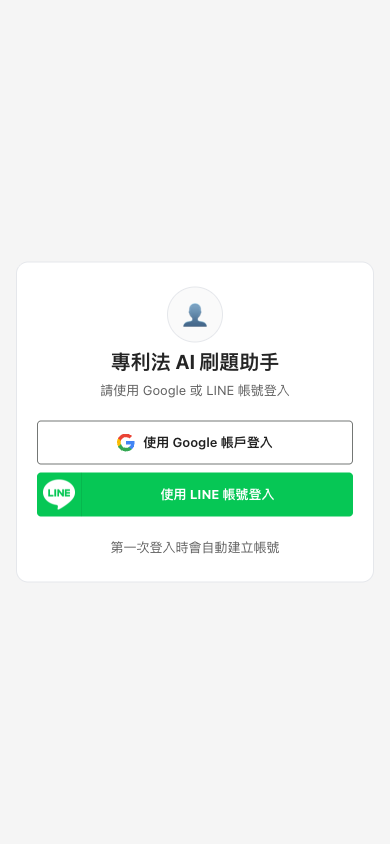

The learner opens the app and sees one white panel on a plain gray
background, titled 「專利法 AI 刷題助手」, with 「請使用 Google 或 LINE 帳號登入」.
The Google button is white with a gray outline and Google's "G". The LINE
button is LINE green. There is no purple gradient and no tab bar, because the
learner is not signed in yet.

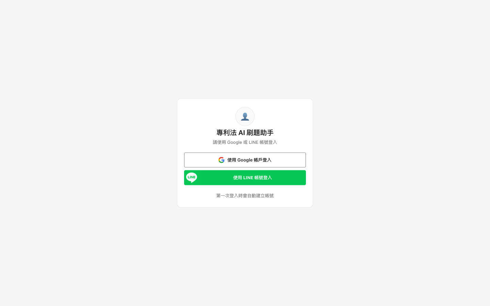

On a computer the same panel sits in the middle of the screen.

### 2. Sign in as a brand-new learner

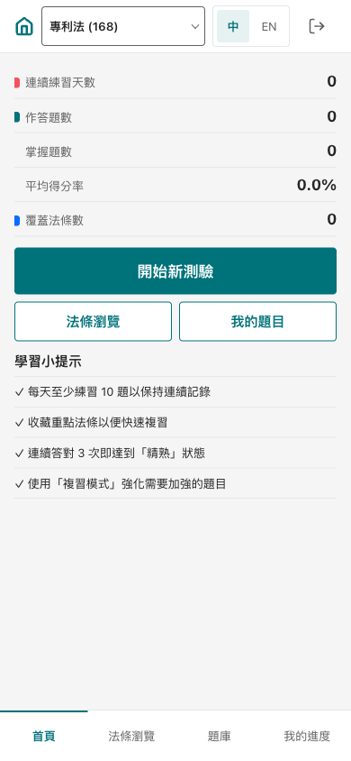

After signing in with Google, the learner lands on 首頁. The top bar holds the
home icon, the law-type picker 「專利法 (168)」, 中/EN, and logout. The tab bar
at the bottom holds 首頁 法條瀏覽 題庫 我的進度, with 首頁 marked by a teal line
on its top edge. The page opens on five numbers on ruled lines:
「連續練習天數」, 「作答題數」, 「掌握題數」, 「平均得分率」, and 「覆蓋法條數」. A new
learner sees `0`, `0`, `0`, `0.0%`, and `0`, with no warning or banner. The
small colored marks before three of the labels say what kind of number each
is: red-pink for the streak, teal for questions answered, and blue for laws
covered. Under the numbers are 開始新測驗, then 法條瀏覽 and 我的題目 side by
side, then 「學習小提示」 as a ruled list. The 💡 is gone from that heading.

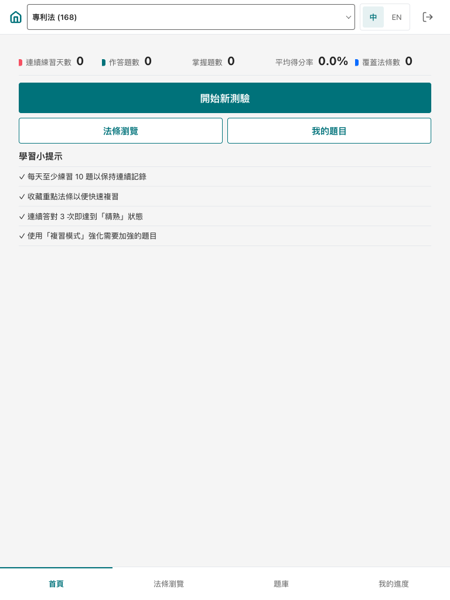

On a tablet the five numbers sit in one row. The bars stay at the top and
bottom.

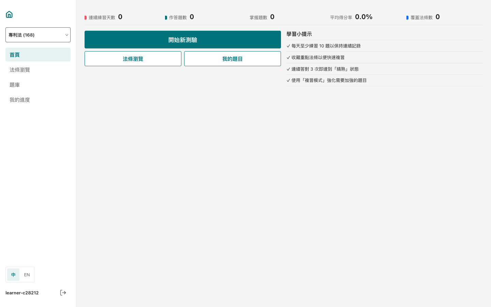

On a computer the bars become a sidebar. It holds the home icon and picker,
the four sections stacked, with 首頁 on a pale teal tint, and 中/EN and the
learner's name 「learner-c28212」 with logout at the bottom. The numbers span
the top. The buttons and the tips sit side by side under them.

### 3. Open 法條瀏覽

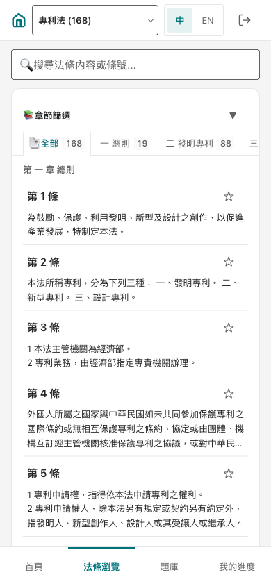

The learner taps 法條瀏覽. A search field sits on top. Below it, one white
panel holds 「📚 章節篩選」 and a row of chapter tabs: 「📑 全部 168」,
「一 總則 19」, 「二 發明專利 88」, and so on. The active tab is white and open
at the bottom, like a folder tab. The row scrolls sideways inside itself, not
the page. Under the tabs, the articles are one list split by thin lines,
with no card per article. Each row shows 「第 N 條」, the first three lines of
the article, and a ☆.

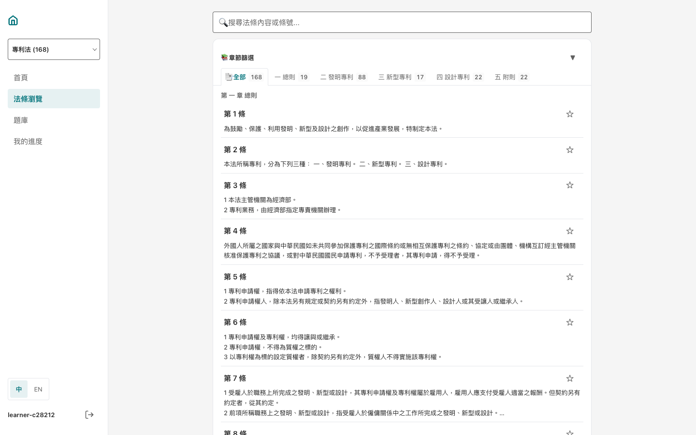

On a computer every chapter tab fits on one line.

### 4. Search for an article

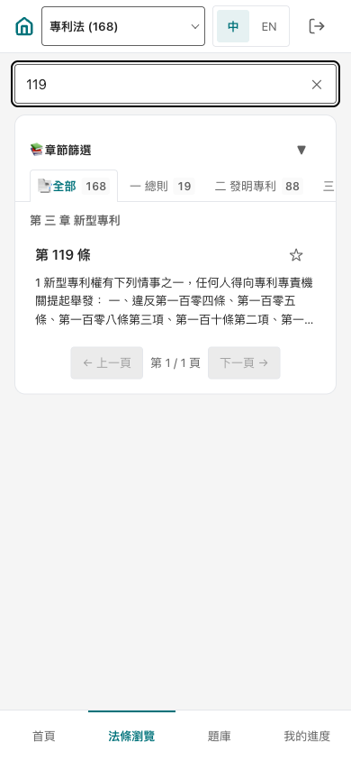

The learner types 「119」. The list narrows to 「第 119 條」 under its chapter,
「第 三 章 新型專利」, and a ✕ appears in the field to clear it.

### 5. Open the article

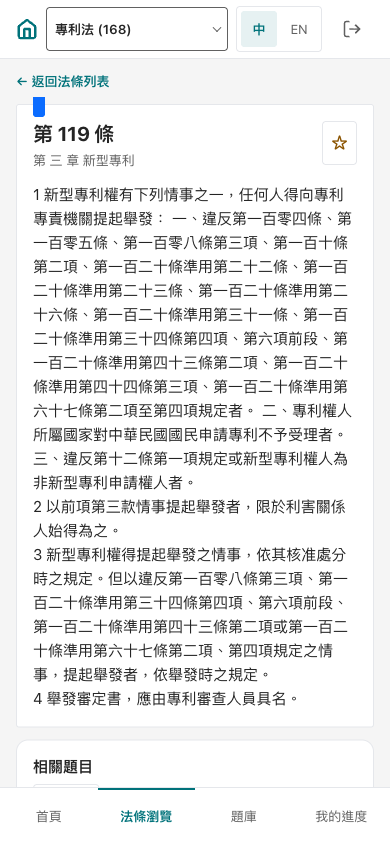

The learner taps 「第 119 條」. A 「← 返回法條列表」 text link sits on top. The
article is a white sheet with square corners and a small blue flag stuck on
its top edge: blue means 法條. Under 「第 119 條」 is the chapter. The article
text wraps inside the sheet, and the long items stay inside it. The 「相關題目」
panel starts below.

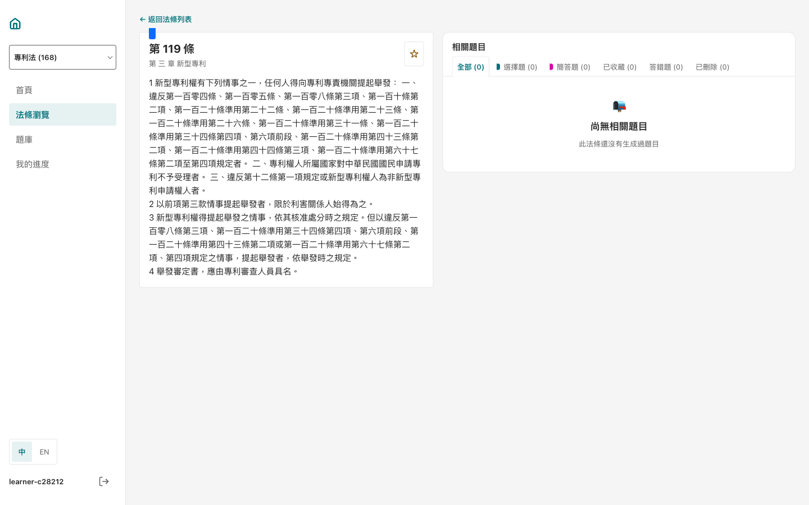

On a computer the page has two columns. The sheet is on the left, and
「相關題目」 is on the right with index tabs 「全部 (0)」 「選擇題 (0)」
「簡答題 (0)」 「已收藏 (0)」 「答錯題 (0)」 「已刪除 (0)」. The 選擇題 tab carries a
teal mark and the 簡答題 tab a magenta one. This learner has answered nothing
yet, so the panel shows 「尚無相關題目」. The 📝 is gone from 「相關題目」.

### 6. Star the article

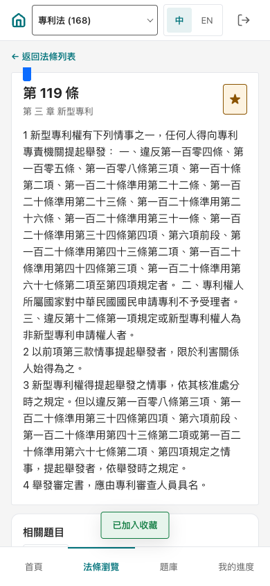

The learner taps ☆. It turns into an amber ★ in an amber box, and a pale
green note 「已加入收藏」 rises above the tab bar for three seconds.

### 7. Set up a quiz

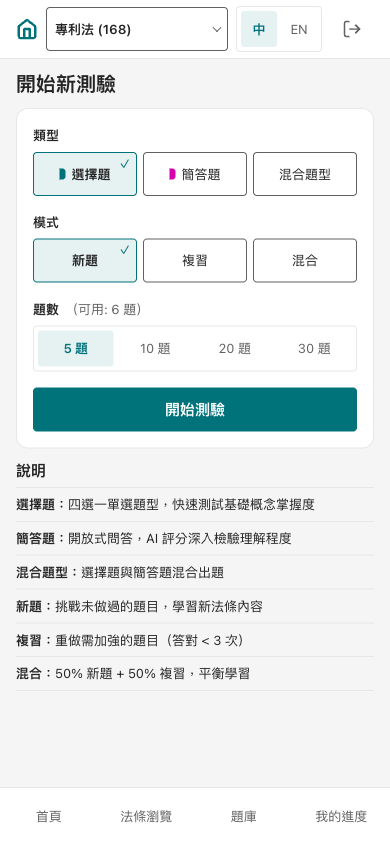

The learner goes back to 首頁 and taps 開始新測驗. 「開始新測驗」 is the page
title. One white panel holds:

- **類型:** three boxes, 選擇題 (with a teal mark), 簡答題 (with a magenta
  mark), and 混合題型. The chosen one has a teal outline, a pale teal fill,
  bold text, and a ✓.
- **模式:** 新題, 複習, and 混合, in the same style.
- **題數:** a hint 「(可用: 6 題)」, then a four-way switch 5 題, 10 題, 20 題,
  and 30 題, styled like 中/EN.

Under the panel, 「說明」 (its 💡 gone) is a ruled list.

### 8. Start the quiz

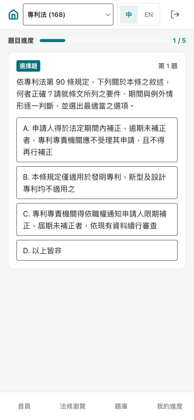

The learner taps 開始測驗. A thin row shows 「題目進度」, a teal bar, and
「1 / 5」. The question panel shows a solid teal 「選擇題」 badge and 「第 1 題」 on
one line, then the question, then four outlined options. The whole question
fits on one phone screen, well above the tab bar.

### 9. Choose an answer

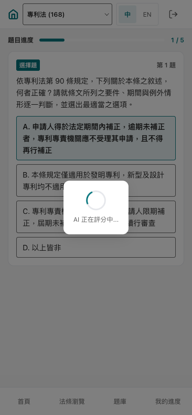

The learner taps A. The option turns pale teal, and a white box
「AI 正在評分中...」 covers the page, the top bar, and the tab bar while the
answer is checked. For this shot the answer was held for two seconds so the
box could be seen.

### 10. See the graded answer

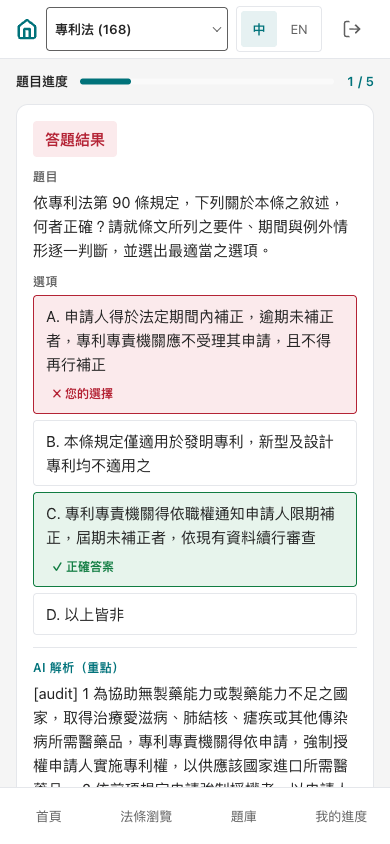

A was wrong. A red badge 「答題結果」 sits on top. Under 「題目」 and 「選項」,
option A is outlined in red with 「✗ 您的選擇」, and C is outlined in green with
「✓ 正確答案」. 「AI 解析（重點）」 follows, with no fill or box: just a thin line
above it and its label in teal. The only filled boxes on the result are the
red and green ones, so the teal text cannot be mistaken for a correct-answer
box. The 💡 is gone from that heading.

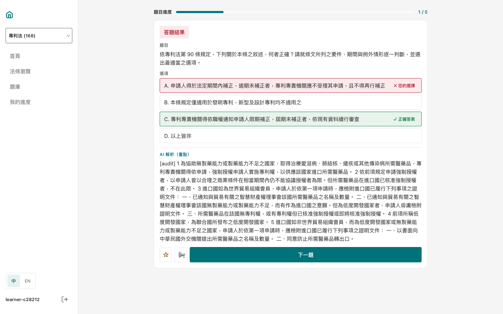

On a computer the result sits in a centered column. The ☆, 📢, and 下一題
buttons share one row, with 下一題 taking the rest of the width. No section in
the sidebar is marked, because the quiz is not one of the four sections.

### 11. Star the question

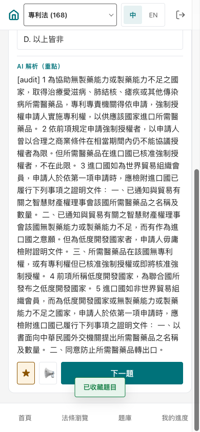

The learner scrolls down and taps ☆. It turns into an amber ★, and
「已收藏題目」 appears above the tab bar.

### 12. Open 「回報題目問題」, then cancel

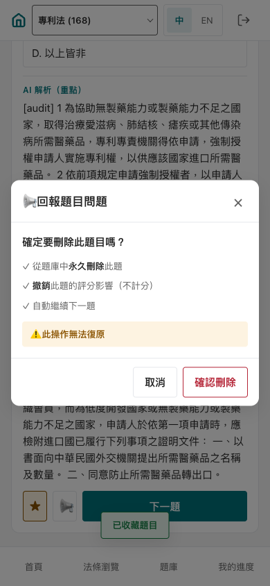

The learner taps 📢. A dialog 「📢 回報題目問題」 opens over a dimmed page,
including the tab bar. It asks 「確定要刪除此題目嗎？」, lists what will happen,
warns 「⚠️ 此操作無法復原」 in an amber box, and offers 取消 and a red-outlined
確認刪除. The learner taps 取消.

### 13. Answer the next question correctly

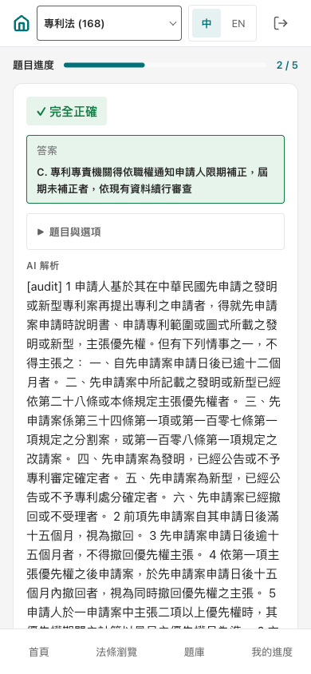

The learner taps 下一題 and chooses C. A green 「✓ 完全正確」 badge sits on top,
then a green box with 「答案」 and the chosen option, then a folded
「▶ 題目與選項」, then 「AI 解析」.

### 14. Finish the quiz

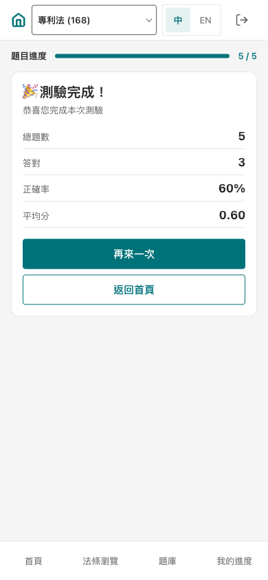

The learner answers the last three questions and taps 查看結果.
「🎉 測驗完成！」 stays as the title. The four results are on ruled lines like
the home page: 「總題數」 `5`, 「答對」 `3`, 「正確率」 `60%`, 「平均分」 `0.60`.
Under them are 再來一次 and 返回首頁.

### 15. Open 我的進度

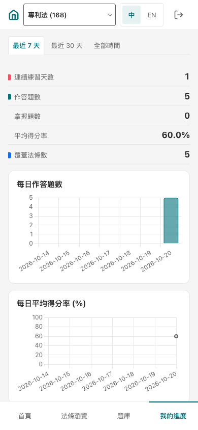

The learner taps 我的進度. Three index tabs, 「最近 7 天」 「最近 30 天」
「全部時間」, sit above the same five numbers as the home page: `1`, `5`, `0`,
`60.0%`, `5`. Two white panels hold the charts. 「每日作答題數」 has teal bars,
and 「每日平均得分率 (%)」 has a gray line, because blue is kept for 法條.

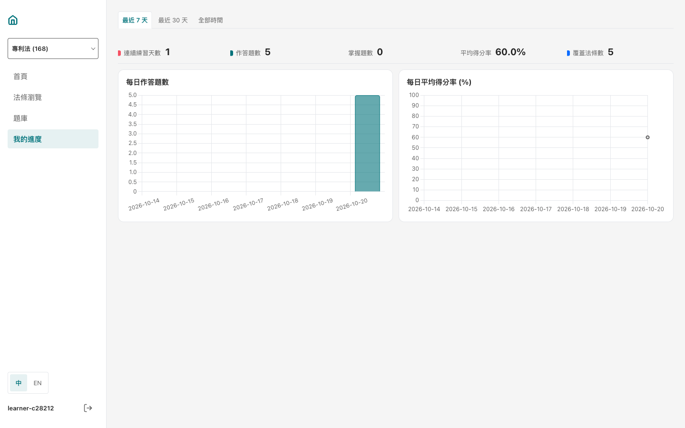

On a computer the two charts sit side by side.

### 16. Open 題庫

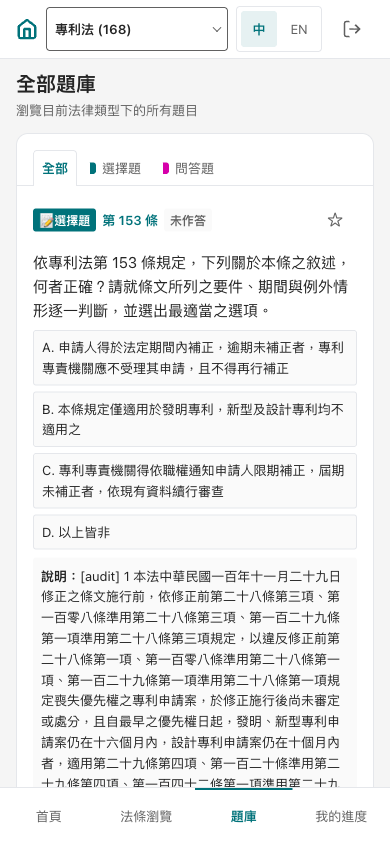

The learner taps 題庫. Under 「全部題庫」 and its subtitle, one panel holds
index tabs 「全部」 「選擇題」 「問答題」 (with teal and magenta marks) and a ruled
list of questions. Each row shows a solid type badge (teal 「📝選擇題」 or
magenta 「✍️問答題」), the article number as a teal link, a gray 「未作答」 badge
where the learner has not answered, the question, and its options.

### 17. Back to 首頁

The learner taps 首頁. The numbers now read `1`, `5`, `0`, `60.0%`, and `5`.
They match 我的進度 because this learner's only day of study is today.

### 18. Open 我的題目

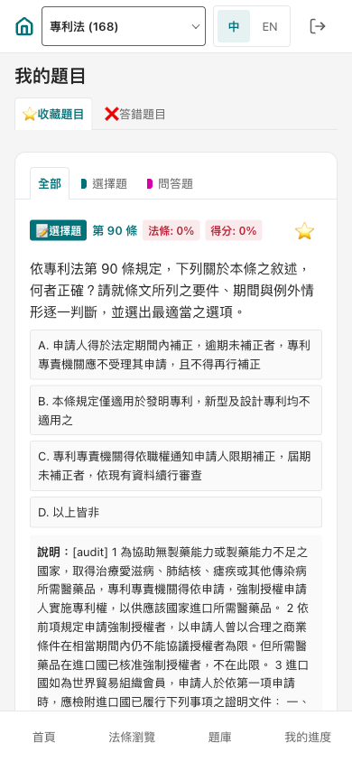

The learner taps 我的題目. 「我的題目」 is the title. Under it, two index tabs
「⭐收藏題目」 and 「❌答錯題目」 sit flush with the page. Below them, one panel
holds the type tabs and the starred question. Its row has the teal type
badge, the article link 「第 90 條」, and red badges 「法條: 0%」 and 「得分: 0%」
for a low score.

### 19. Switch to 答錯題目

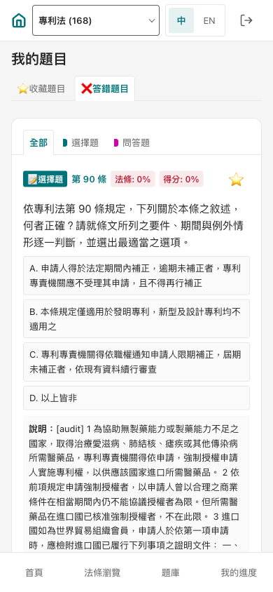

The learner taps 「❌答錯題目」. That tab becomes the open one, and the list
shows the questions answered wrong.

### 20. Follow the article link

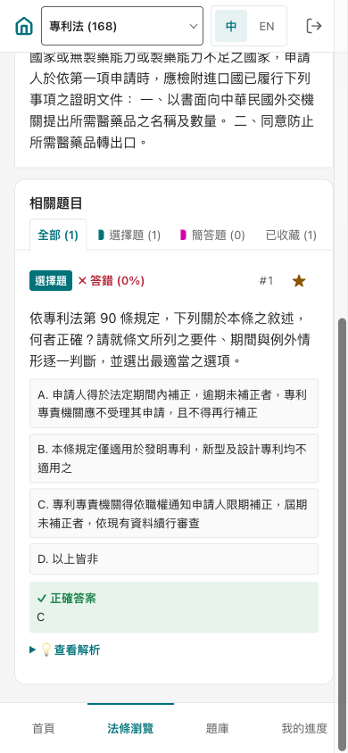

The learner taps 「第 90 條」 and scrolls to 「相關題目」. The panel now shows the
answered question in a ruled list: the teal 「選擇題」 badge, 「✗ 答錯 (0%)」 in
red, 「#1」 and an amber ★, the question, its options in light gray boxes, a
green 「✓ 正確答案」 box, and 「▶ 💡 查看解析」.

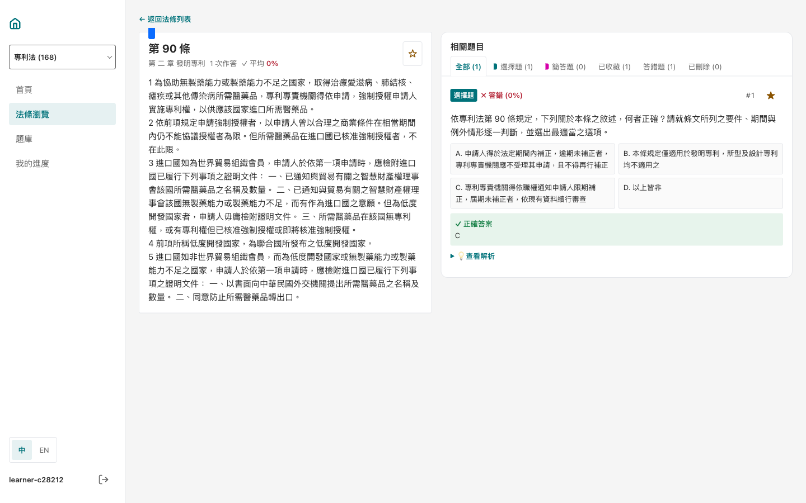

On a computer the sheet's meta line reads 「第 二 章 發明專利 1 次作答 ✓ 平均
0%」, with the 📊 gone. 「0%」 is red because it is low. The question sits on
the right.

### 21. Switch to a law type with no records

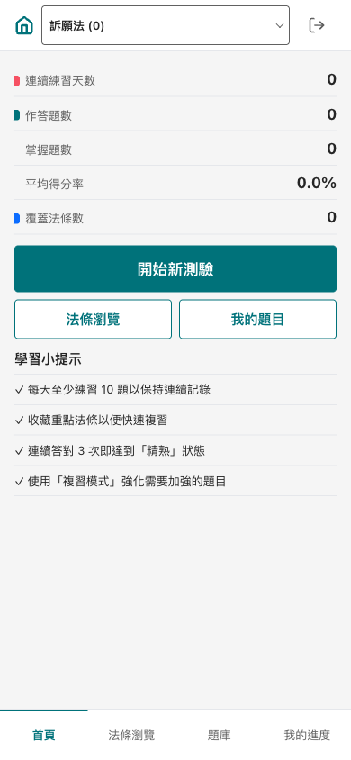

The learner picks 「訴願法 (0)」 in the picker. The page reloads and the five
numbers read `0`, `0`, `0`, `0.0%`, and `0`, because this learner has studied
only 專利法. 中/EN disappears, because 訴願法 has no English text. The picker
grows to fill the space, and the bar keeps its shape. The learner switches
back to 專利法.

### 22. Log out

The learner taps logout and confirms 「確定要登出嗎？」. The sign-in page
returns with a pale green 「已登出」 note above the buttons.

## Edge Cases

| PRD row | Scenario | What the user sees | Evidence | Result |
| --- | --- | --- | --- | --- |
| BR-1 | The home numbers cover all time, for the chosen law type, and follow a law-type switch | 專利法 shows the quiz's numbers, and 訴願法 shows zeros | [screenshot](shots/17-dashboard-after-quiz-phone.png), [screenshot](shots/21-other-law-type-phone.png); `tests/test_app.py::TestDashboard::test_shows_all_time_numbers` and `::test_other_law_type_does_not_count` (two days of records add up to `12`, `75.0%`, 3 laws, streak 2) | Pass |
| BR-2 | A learner with no records | 「連續練習天數」 `0` … 「平均得分率」 `0.0%` … `0`, with no banner or new text | [screenshot](shots/02-new-learner-dashboard-phone.png); `tests/test_app.py::TestDashboard::test_no_records_shows_zeros_without_banner` | Pass |
| BR-3 | A learner who has only older-style records (per-law totals, no daily records) | 首頁 shows `0`, `5`, `0`, `60.0%`, `5` from those totals, with no banner. 我的進度 shows the same numbers and the notice 「以上數據為歷史累積總計。每日趨勢圖將從今日作答後開始記錄。」 | [screenshot](shots/23-legacy-dashboard-phone.png), [screenshot](shots/24-legacy-progress-phone.png) | Pass |
| BR-4 | Each hue means one thing on every page | Teal: buttons, links, the active tab, the progress bar, 選擇題, and 作答題數. Blue: the article flag and 覆蓋法條數. Magenta: 簡答題 and 問答題. Red-pink: the streak. Gray: 掌握題數, 平均得分率, and the score chart | [screenshot](shots/02-new-learner-dashboard-phone.png), [screenshot](shots/05-law-detail-desktop.png), [screenshot](shots/07-quiz-config-phone.png), [screenshot](shots/15-progress-phone.png), [screenshot](shots/16-question-bank-phone.png) | Pass |
| BR-5 | Green, red, amber, and light blue appear only for status | Score badges, answer review, notes, the 「已登出」 alert, stars, the dialog warning, and the older-records notice | [screenshot](shots/10-graded-wrong-phone.png), [screenshot](shots/06-law-starred-phone.png), [screenshot](shots/12-report-modal-phone.png), [screenshot](shots/22-logged-out-phone.png), [screenshot](shots/24-legacy-progress-phone.png), [screenshot](shots/25-law-not-found-phone.png) | Pass |
| BR-6 | One typeface everywhere | Every element on every page uses the same 黑體 typeface | Checked by script in the browser: every signed-in page and the sign-in page, at all three screen sizes, found one typeface each | Pass |
| BR-7 | The shell's controls on every page but sign-in | Home icon, the four sections, the picker, 中/EN, and logout. The name shows from desktop width. 中/EN hides for law types without English, and the bar keeps its shape | [screenshot](shots/02-new-learner-dashboard-phone.png), [screenshot](shots/02-new-learner-dashboard-desktop.png), [screenshot](shots/21-other-law-type-phone.png); `tests/test_app.py::TestShell::test_page_renders_in_shell` (8 pages, each with the four sections and the right one marked) | Pass |
| BR-8 | Color values live only in the token file | Nothing a learner sees. Brand colors come from named Google and LINE tokens, and the "G" colors live in its image file | `tests/test_design_tokens.py::test_no_color_literal_outside_tokens`, `::test_tokens_cover_the_contract`, `::test_figma_token_files_are_retired` (test only) | Pass |
| BR-9 | Every page holds at phone, tablet, and desktop | No sideways page scroll, and nothing spilling out of its box | Checked by script in this environment: 8 signed-in pages × 3 sizes (24 checks) plus the sign-in page × 3, all passing. The quiz's question, graded, summary, and dialog states were checked the same way during implementation against the same code: 51 checks, all passing | Pass |
| BR-10 | The graded quiz keeps teal and green apart | 「AI 解析（重點）」 has no fill, only a line above it and a teal label. The only filled boxes are red and green | [screenshot](shots/10-graded-wrong-phone.png) | Pass |
| BR-11 | Overlays sit above the bars | The grading box and the report dialog cover the top bar and the tab bar. The dialog's buttons are clear of the tab bar | [screenshot](shots/09-grading-overlay-phone.png), [screenshot](shots/12-report-modal-phone.png) | Pass |
| BR-12 | Long content wraps inside its box. Tab rows scroll inside themselves | The long Article 119 and the long explanations wrap inside the sheet and panels. The chapter tabs run off the right edge inside their row | [screenshot](shots/05-law-detail-phone.png), [screenshot](shots/03-laws-list-phone.png); the BR-9 check found no page scroll | Pass |

One more state from the PRD's Before → After was shown: a law address that
does not exist. The page shows 「⚠️ 載入失敗」 in red with the server's
message, and a red note above the tab bar.
[screenshot](shots/25-law-not-found-phone.png)

## API Changes

| Method and path | Who can call it | What it does | Change |
| --- | --- | --- | --- |
| `GET /` | Signed-in learners. Anyone else is sent to the sign-in page | Shows the home page, now with the learner's five all-time progress numbers for the chosen law type | Changed |

No other route or API changed.

## Database Changes

None. The home page reads the same progress records 我的進度 already reads.
No field, index, or collection changed, and `docs/modules/db/data-model.md`
has no Change Log row for this ticket.

## Deviations From the PRD

- None.

## How It Was Verified

- Automated tests: 116 passed, 0 failed (`pytest`). That includes 15 new tests
  for the home numbers, the shell on every page, and the token rules.
- Code style check: clean (`flake8`).
- The app: run locally as in Environment, and driven in a browser with
  Playwright at phone size, with desktop and tablet shots where the layout
  differs.
- **Console:** no errors during the journey. Two exceptions:
  - The browser's request for `favicon.ico` returns "not found". The app has
    never had an icon file, so this predates the change.
  - Shot 25 shows the expected server refusal of a bad address.
- **Build order:** the PRD's first step was skipped. That step pointed the old
  color names at the new tokens as a temporary bridge. The stylesheet was
  rewritten in one pass, so nothing needed bridging. This changes how the
  work was built, not what the app does. The changelog records it.
