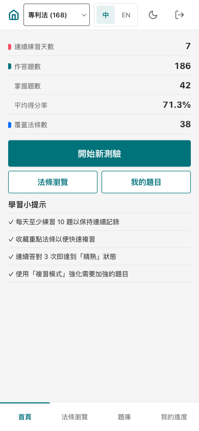
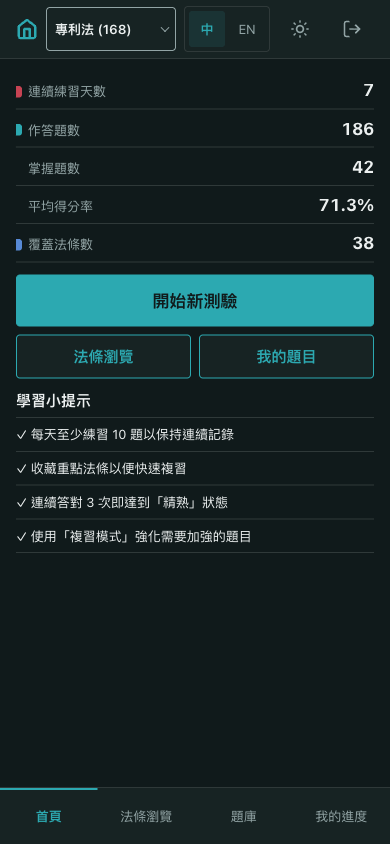
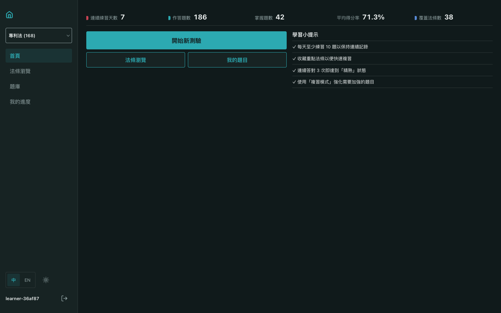
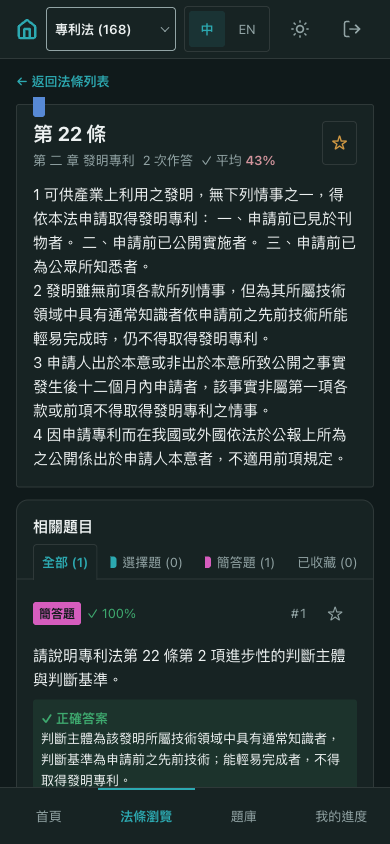
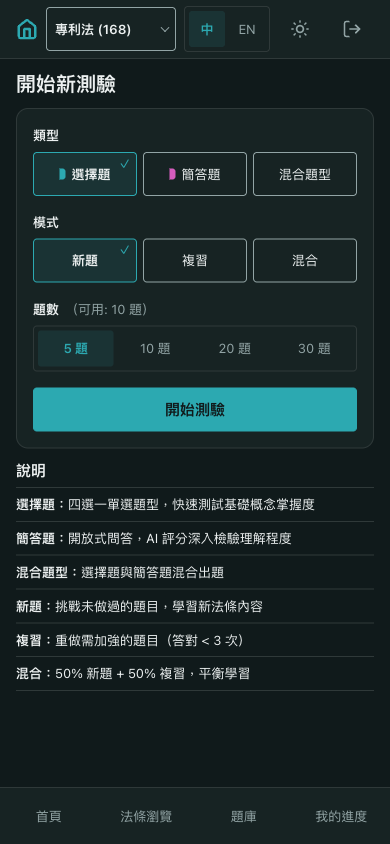
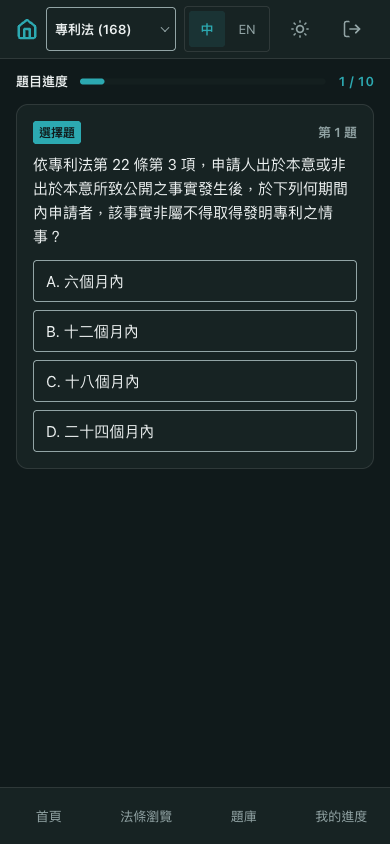
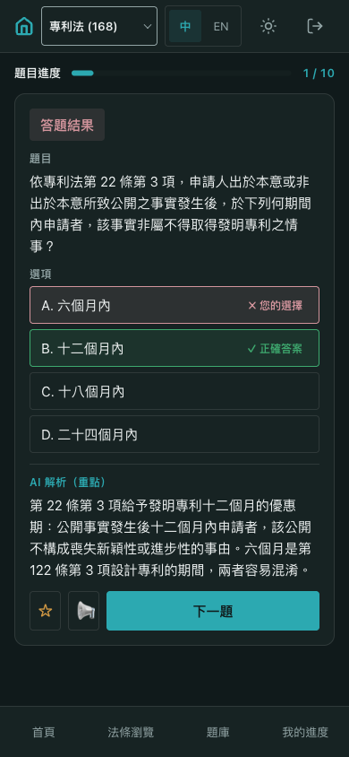
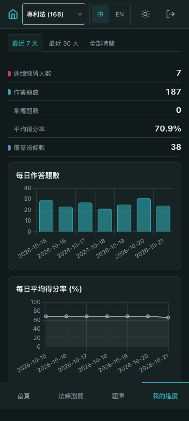
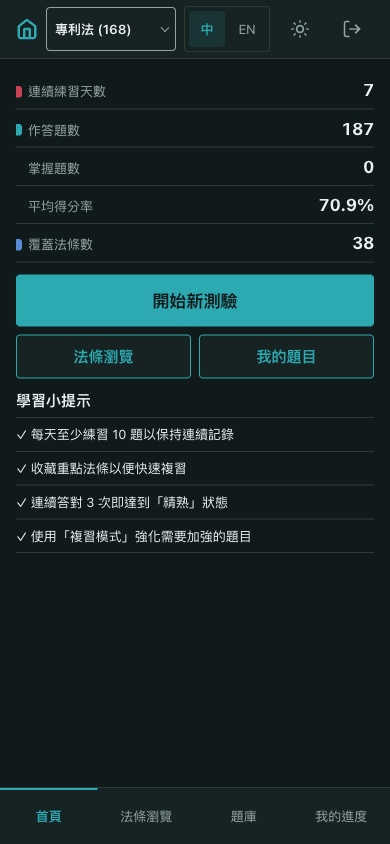

# Report: Dark mode, with each learner's choice stored in user_ui_flags

- **Ticket:** `LP-0004-09`, listed in [docs/issues/](../../issues/README.md).
- **PRD:** [LP-0004-09-dark-mode](../../prd/LP-0004-09-dark-mode.md)
- **Changelog:** [2026-10-21-dark-mode](../../changelog/2026-10-21-dark-mode.md)
- **Verified at:** commit `f7ac0f4` + working tree. The ticket's code is not
  committed yet.
- **Environment:**
  - The app ran locally with `python app.py` on `http://localhost:5001`.
  - Its database was `lp_report_0004_09`, on a local MongoDB 7 (the image CI
    uses) and created for this report.
  - One test Google account signed itself up as `learner-36af87` on its
    first sign-in. It signed in a second time through Google's account
    chooser.
  - OpenRouter had no key, so no AI service was called. The journey grades
    one multiple-choice question, which the app marks without AI.
  - The browser reported an operating-system **dark** setting the whole time,
    so every light screen below also shows that the app ignores it.
  - Google's own screens are not shown.
- **Seed data (stand-in):**
  - The 168 patent-act articles, from the repo's `knowledge/truth_law.json`,
    so the law page has real law text.
  - Eleven questions: two on 第 22 條, the same wording as the `LP-0004-08`
    mock, and nine marked 「（示意題目）」.
  - After the account signed up, seven days of study records for it (186
    answers at 71.3%), one law score, one answered question, and one starred
    question, so the home page and the charts have numbers.
  - No theme setting was seeded. The account had none until it clicked the
    toggle.
- **Prepared by:** Claude, 2026-10-21.

## Summary

Learners can now switch the app to a dark theme with a button next to 中/EN.
The choice is saved to their account, not to the browser. It comes back on
every page, after a reload, and after signing in again, and the first frame
is already dark. A learner who never switches sees the light theme, which is
the default, whatever their phone's own setting is. The login page always
stays light, because no one is signed in there yet. The dark colors are the
`teal-ink` palette the user picked, each one worked out from its light
counterpart so text and marks stay as readable as in light.

## User Journey

The happy path, one step per user action, on a phone (390x844).

### 1. Open the app signed out

The learner opens the app and sees the light login page: 「專利法 AI
刷題助手」, 「使用 Google 帳戶登入」, and 「使用 LINE 帳號登入」. This is the same
in light and dark, even though the phone is set to dark.

### 2. Sign in for the first time

After signing in with Google, the learner lands on the home page in light,
with no theme saved yet. The top bar has a new moon button between 中/EN and
logout, labeled 「深色模式」. The phone's dark setting does not change the
page.

### 3. Switch to dark

The learner taps the moon. The page reloads in dark: a faint teal-black
ground, light text, and teal buttons with dark labels. The button now shows
a sun and reads as pressed. The choice is saved to the account.

On a computer the same button sits in the sidebar, beside 中/EN:

### 4. Read a law

The learner opens 第 22 條. The law sheet, its blue 法條 flag, the related
questions, the magenta 「簡答題」 badge, and the green 「✓ 正確答案」 box all
show in dark.

### 5. Set up a quiz

The learner opens 開始新測驗 and picks 選擇題, 新題, and 10 題.

### 6. See the question

The quiz opens on 第 1 題, the 第 22 條 question with its four options. The
nine other questions are stand-ins, and this one was moved to the front of
the session so the step shows real law content.

### 7. Answer it wrong

The learner picks 「A. 六個月內」. The result marks it 「✗ 您的選擇」 in rose and
「B. 十二個月內」 as 「✓ 正確答案」 in green. 「AI 解析（重點）」 follows in teal,
with no fill.

### 8. Check progress

The learner opens 我的進度. Both charts draw in dark colors: teal bars for
每日作答題數 and a gray-teal line for 每日平均得分率. 掌握題數 reads 0 because
answering in step 7 recounted today's mastered questions from the stand-in
records. That is the app's normal rule, not part of this ticket.

### 9. Sign out

The learner taps logout and confirms 「確定要登出嗎？」. The login page shows
「已登出」 in light, although the account is saved as dark.

### 10. Sign in again

The learner signs in again through Google's account chooser. The home page
opens straight in dark, with the sun button pressed. The page the server
sent already said dark before any style loaded, so no light frame showed
first.

## Edge Cases

| PRD row | Scenario | What the user sees | Evidence | Result |
| --- | --- | --- | --- | --- |
| BR-1 | A learner who never chose a theme | The light theme and the moon button | [screenshot](shots/02-dashboard-light-phone.png); `tests/test_app.py::TestUiFlags::test_no_document_renders_light` | Pass |
| BR-2 | A learner saved as dark opens any page | Dark from the first frame | [screenshot](shots/11-signed-in-again-dark-phone.png); the server's page began with the dark setting ahead of every style; `tests/test_app.py::TestUiFlags::test_renders_the_stored_dark` (home and 我的進度) | Pass |
| BR-3 | The same learner on another browser, or signing in again | Their saved theme | [screenshot](shots/11-signed-in-again-dark-phone.png): a new sign-in. In the earlier local check, a second browser with its own session also opened dark. | Pass |
| BR-4 | A dark learner signs out | The light login page, with the Google and LINE buttons in their usual colors | [screenshot](shots/10-logout-login-light-phone.png); `tests/test_app.py::TestUiFlags::test_login_stays_light` | Pass |
| BR-5 | The phone is set to dark, but the learner chose light | Light | [screenshot](shots/02-dashboard-light-phone.png), with the browser reporting dark; `tests/test_design_tokens.py::test_no_os_theme_reading` | Pass |
| BR-6 | Dark colors stay readable | Text, labels on buttons, and flags as easy to tell apart as in light | Each dark color carries its contrast numbers in the token file, all at or above the ticket's minimums (artifact `DECISION.md`); `tests/test_design_tokens.py::test_dark_names_exist_in_light` and `::test_no_color_literal_outside_tokens` (test only) | Pass |
| BR-7 | Colors keep their meaning | Teal for actions and 選擇題, blue for 法條, magenta for 簡答題, flamingo for the streak, green and rose for right and wrong | [screenshot](shots/04-law-dark-phone.png), [screenshot](shots/07-quiz-result-dark-phone.png) | Pass |
| BR-8 | The button is always there | The moon or sun beside 中/EN on every signed-in page, at every size, at least a fingertip wide | [phone](shots/03-dashboard-dark-phone.png), [desktop](shots/03-dashboard-dark-desktop.png); the earlier local check measured it on all 8 signed-in pages at 3 sizes in both themes | Pass |
| BR-9 | Charts in dark | Teal bars and a gray-teal line on dark panels | [screenshot](shots/08-progress-dark-phone.png) | Pass |
| BR-10 | Built-in controls in dark | The law-type picker's list and the scrollbars draw dark | The page reported its color scheme as dark in the earlier local check. The phone's own picker list cannot be screenshotted. | Pass |
| BR-11 | A bad value is sent to the save address | Nothing is saved, and an error comes back | `tests/test_app.py::TestUiFlags::test_bad_value_writes_nothing`: seven bad bodies, among them 「blue」, 「Dark」, a number, and plain text (test only) | Pass |
| BR-12 | Someone signed out tries to save | Refused, and nothing is saved | `tests/test_app.py::TestUiFlags::test_signed_out_gets_401` (test only) | Pass |
| BR-13 | Saving fails | The error toast 「HTTP 500」. No reload, and the page stays as it was. | [screenshot](shots/09-save-fails-phone.png): the save was made to fail in the browser. The saved theme stayed dark. | Pass |
| BR-14 | Every page at three sizes in both themes | No sideways scrolling and nothing spilling out of its box | The earlier local check covered 8 signed-in pages plus login, at 390x844, 768x1024, and 1440x900, in light and dark: 51 checks, all passed, screenshots looked at | Pass |

## API Changes

| Method and path | Who can call it | What it does | Change |
| --- | --- | --- | --- |
| `PUT /api/ui-flags/theme` | Signed-in learners. A signed-out call is refused. | Saves the learner's theme, light or dark, to their account. Anything else is refused. | New |
| Every signed-in page | Signed-in learners | Each page now tells the browser the learner's saved theme as it arrives | Changed |
| `GET /auth/login` | Anyone | Unchanged. It always shows the light theme. | Unchanged |

## Database Changes

| Collection | What changed | Existing data | Migration | Where it ran |
| --- | --- | --- | --- | --- |
| `user_ui_flags` | New. One record per learner holds their theme and when they last changed it. Each learner can have only one. | None existed. A learner with no record gets light, so nothing was filled in. | None | Locally, where the app built it on start. Not yet run on production. |
| `user_ui_flags`, in the old account cleanup script | The `LP-0002-01` script that removes old username-only accounts now also removes their theme records. | No change to existing records | `scripts/migrations/20261016_remove_username_only_users.py`, edited | Its tests pass locally. The script itself is not yet run on production; that is owned by `LP-0007`. |

## Deviations From the PRD

- None open. One was found during the walk and settled with the user on
  2026-10-21, before this draft. The PRD said a failed save shows the
  server's error or 「請求失敗，請稍後再試」. The app shows 「HTTP 500」 for a
  server failure, because it reuses the app-wide error toast, which shows
  the status code when the reply is not readable. The user chose to correct
  the PRD's description and keep the code, so there is no new wording.

## How It Was Verified

- Automated tests: 131 passed, 0 failed (`pytest`).
- Code style check: clean (`flake8`).
- The app: run locally as in Environment, and driven in a browser with
  Playwright at phone size. There were no console errors apart from the two
  that step BR-13's staged failure is meant to cause.
- Before this report, the same build ran on a separate local database
  (`lp_0004_09`). There, every page was checked and screenshotted at three
  sizes in both themes, and a second browser was signed in for the same
  learner.
