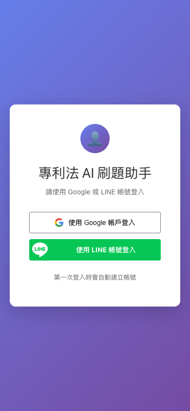
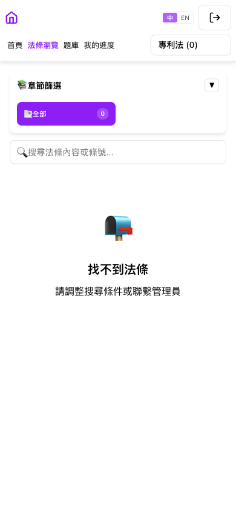
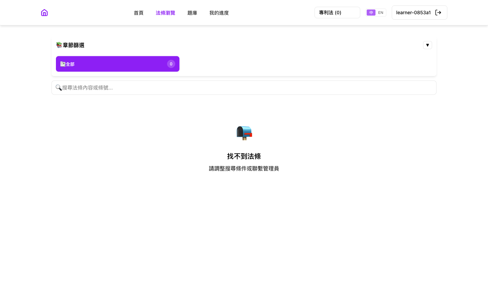
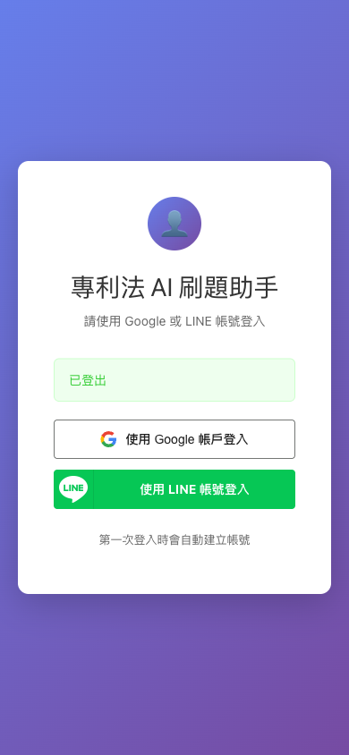
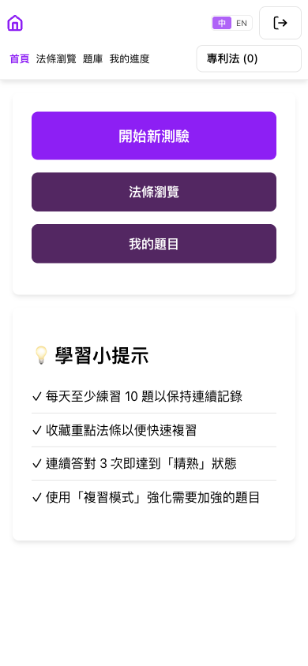
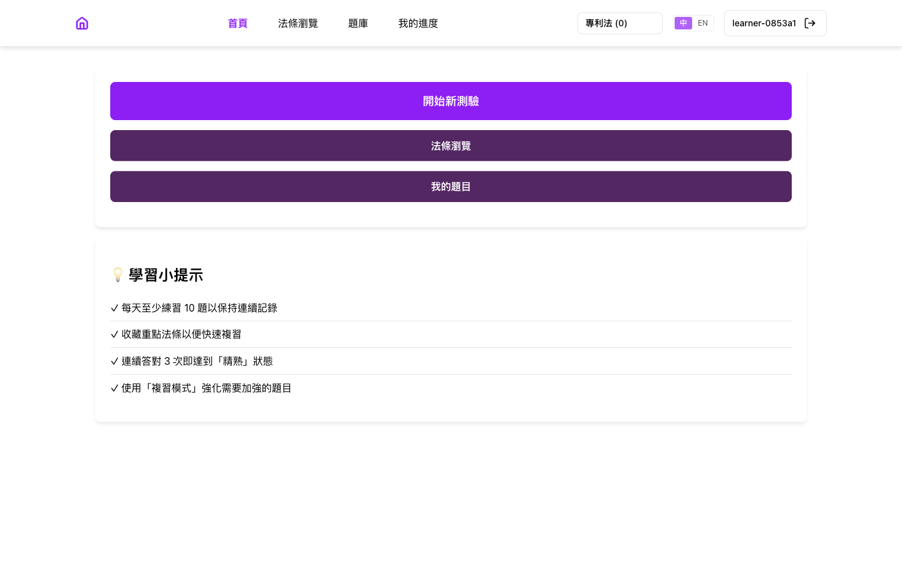

# Report: LINE Login with self-signup

- **Ticket:** `LP-0009`, listed in [docs/issues/](../../issues/README.md).
- **PRD:** [LP-0009-line-login](../../prd/LP-0009-line-login.md)
- **Changelog:** [2026-10-18-line-login](../../changelog/2026-10-18-line-login.md)
- **Verified at:** commit `ee6b11a`, merged to `main` as `db9dbbc` and
  deployed as Heroku release v13. The working tree adds docs only.
- **Environment:** the app run locally with `python app.py` on
  `http://localhost:5001`, database `lp_report_0009` on a local MongoDB,
  created empty for this report. One LINE test account signed itself up as
  `learner-0853a1`. Seed data: none. The journey needs no laws or questions,
  so 法條瀏覽 shows its empty state. LINE's own screens are not shown,
  because they display the account's name and photo. No LINE password was
  typed: the browser still held the LINE session from the user's hand
  sign-in earlier the same day.
- **Prepared by:** Claude, 2026-10-18.

## Summary

Learners can now sign up and sign in with their LINE account, the app most
of them already use, as well as with Google. The sign-in page shows the
Google button first and a green LINE button below it. A first LINE sign-in
creates the account automatically, with the same kind of random name as
Google, such as `learner-0853a1`. The app never asks LINE for the learner's
name, picture, or email, and a LINE account is never joined to a Google
account. A cancelled or forged sign-in is refused with 「登入失敗，請重試」 and
leaves nothing behind. After logging out, LINE asks the learner to confirm
which account to use instead of signing them straight back in.

## User Journey

The happy path, one step per user action, on a phone (390x844).

### 1. Open the app while signed out

The learner opens 法條瀏覽 and is sent to the sign-in page. It reads
「請使用 Google 或 LINE 帳號登入」, with the white 「使用 Google 帳戶登入」 button
on top and, below it, the green 「使用 LINE 帳號登入」 button with LINE's
official icon. The footer still reads 「第一次登入時會自動建立帳號」.

### 2. Sign in with LINE for the first time

The learner taps the LINE button and confirms their LINE account on LINE's
page. They land back on 法條瀏覽, the page they first asked for, signed in to
a brand new account named `learner-0853a1`. On a phone the header hides the
name to save space, as it does for Google accounts. At desktop width the name
shows next to the logout button. The database holds one new account, with no
email and no LINE name or picture.

### 3. Log out

The learner taps the logout button and confirms 「確定要登出嗎？」. They land on
the sign-in page with 「已登出」.

### 4. Sign in with LINE again

The learner taps the LINE button again. Because they just logged out, LINE
shows its sign-in screen and asks them to confirm the account, rather than
signing them in silently. They confirm and land on the home page as the same
`learner-0853a1`. The database still holds exactly one account for them.

## Edge Cases

| PRD row | Scenario | What the user sees | Evidence | Result |
| --- | --- | --- | --- | --- |
| BR-1 | LINE's proof of identity is checked with the channel's secret, and anything else is refused | A real LINE sign-in works. A forged, expired, or mis-addressed proof gets 「登入失敗，請重試」 | Journey steps 2 and 4 with real LINE; `tests/test_auth.py::test_signed_line_id_token_signs_in` and `::test_bad_line_id_token_is_refused` (8 bad proofs) | Pass |
| BR-2 | A LINE account the app has never seen signs itself up | Lands signed in as a new `learner-…` account | Journey step 2; `tests/test_auth.py::test_new_line_sub_signs_itself_up_once` | Pass |
| BR-3 | A refused sign-in writes nothing | 「登入失敗，請重試」, and still signed out | [cancel](shots/05-cancel-on-line-phone.png), [forged](shots/06-callback-opened-directly-phone.png): the account count and last sign-in time were unchanged afterwards; `tests/test_auth.py::test_line_oauth_failure_is_refused`, `::test_line_claims_without_a_string_sub_are_refused` | Pass |
| BR-4 | LINE's name, picture, and email are never stored, and a sign-in never renames the learner | The header keeps the learner's own name | Journey step 2 (the new account holds no LINE profile data); `tests/test_auth.py::test_existing_line_user_keeps_its_name` | Pass |
| BR-5 | Google and LINE accounts are never joined | Each sign-in reaches only its own account | `tests/test_auth.py::test_line_and_google_accounts_stay_separate` (test only) | Pass |
| BR-6 | The page the learner asked for survives the trip to LINE, and only if it is on this site | Lands on 法條瀏覽; a link to another site lands on the home page | Journey step 2; `tests/test_auth.py::test_line_next_is_validated_through_the_round_trip` | Pass |
| BR-7 | The app refuses to start without the LINE channel's ID or secret | The app does not start, and names the missing setting | `tests/test_auth.py::test_startup_fails_without_oauth_config` (test only) | Pass |
| BR-8 | After logout, the next sign-in asks which account to use, once, on whichever button is tapped first | LINE asks to confirm the account | Journey step 4; `tests/test_auth.py::test_first_line_sign_in_after_logout_shows_line_login_once`, `::test_logout_flag_goes_to_the_first_button_clicked` | Pass |
| BR-9 | On Heroku, LINE sends the learner back over a secure (https) address | Sign-in works on the live site | Checked on production: the live LINE button sends an https return address, and the user's LINE test account signed in there on 2026-10-18; `tests/test_auth.py::test_line_redirect_is_https_behind_heroku` | Pass |
| BR-10 | Many accounts without an email, or without a LINE ID, never clash | Every new learner gets in | `tests/test_auth.py::test_null_identities_never_clash`, `tests/test_migrations.py::test_init_db_rebuilds_email_index_as_partial` (test only) | Pass |
| E-1 | The learner cancels on LINE's page | 「登入失敗，請重試」 | [screenshot](shots/05-cancel-on-line-phone.png): staged by returning to the app exactly as LINE does on a cancel; `tests/test_auth.py::test_line_oauth_failure_is_refused` | Pass |
| E-2 | The LINE return address is opened directly, or replayed | 「登入失敗，請重試」 | [screenshot](shots/06-callback-opened-directly-phone.png); `tests/test_auth.py::test_line_oauth_failure_is_refused` | Pass |
| E-3 | Two first sign-ins with the same LINE account happen at the same moment | One account, which both end up in | `tests/test_auth.py::test_same_sub_race_uses_the_winning_account` (test only) | Pass |
| E-4 | The random name drawn is already taken | Another name is drawn | `tests/test_auth.py::test_random_name_clash_draws_another` (test only; Google and LINE share this step) | Pass |
| E-5 | An already signed-in learner starts a LINE sign-in | Goes straight to the home page | [screenshot](shots/07-already-signed-in-phone.png); `tests/test_auth.py::test_signed_in_user_skips_line` | Pass |
| E-6 | One person signs in with Google and with LINE | Two separate accounts, with separate progress | `tests/test_auth.py::test_line_and_google_accounts_stay_separate` (test only) | Pass |
| E-7 | The LINE channel is moved to another LINE provider | Every LINE learner would arrive as a new, empty account, so the move is forbidden | The rule is written in the auth module doc's Operations section and in `.env.example`; an unseen LINE account becoming a new account is BR-2 | Pass |
| E-8 | The LINE channel is still in its "Developing" state | Only the channel's admins could sign in | The user published the channel on 2026-10-18, before the production check (confirmed by the user in LINE's console; the app cannot see it) | Pass |
| E-9 | Opened inside LINE's own browser, LINE may sign in without asking | A normal sign-in | Handled as any successful sign-in: `tests/test_auth.py::test_signed_line_id_token_signs_in` (test only) | Pass |

## API Changes

| Method and path | Who can call it | What it does | Change |
| --- | --- | --- | --- |
| `GET /auth/login` | Anyone. Signed-in learners go to the home page | Shows the sign-in page, now with a LINE button below the Google button | Changed |
| `GET /auth/line` | Anyone. Signed-in learners go to the home page | Remembers the page asked for, then sends the learner to LINE | New |
| `GET /auth/line/callback` | Anyone, but only a genuine return from LINE signs in | Checks LINE's proof of identity, finds or creates the account, signs the learner in | New |
| `GET /auth/logout` | Anyone | Signs out. Its one-time "ask which account" mark now also serves the LINE button | Unchanged route |
| `GET /auth/google`, `GET /auth/google/callback` | Anyone | Google sign-in | Unchanged |
| `GET /auth/current` | Signed-in learners | Reports who is signed in | Unchanged |

## Database Changes

| Collection | What changed | Existing data | Migration | Where it ran |
| --- | --- | --- | --- | --- |
| `users` | New `line_user_id`: the LINE account's ID, kept for LINE accounts only, and unique | Older Google accounts simply lack it | none | Locally, and on production at release v13 |
| `users` | `email` is now optional: Google accounts have one, LINE accounts do not | Every existing account keeps its email | none | Locally, and on production at release v13 |
| `users` | The email and LINE ID uniqueness rules now apply only where the value is present, so many LINE accounts without an email never clash. The old email rule is replaced once, at startup | Unaffected: the old rule already kept emails unique | none (done by the app at startup) | Locally, and on production at release v13. The first production startup failed once, then succeeded on Heroku's automatic restart (see How It Was Verified) |
| `users` and the six per-learner collections | The one-off cleanup from the Google sign-in work now removes only accounts with neither an email nor a LINE ID, so it can never delete a LINE account | None affected | `scripts/migrations/20261016_remove_username_only_users.py`, edited | Not yet run on production. Running it belongs to `LP-0007` |

## Deviations From the PRD

- None.

## How It Was Verified

- Automated tests: 101 passed, 0 failed (`pytest`). The 37 that cover the
  rows above were also run on their own and passed. LINE and Google are never
  called by the tests.
- Code style check: clean (`flake8`).
- The app: run locally as in Environment, and driven in a browser with
  Playwright at phone size. The app's own pages raised no errors. Two console
  errors were seen and are not from this change: the browser's automatic
  request for a site icon, which the app has never had, and a sign-in check
  made by the reviewer's own script to confirm a refused sign-in stayed
  signed out.
- Production: release v13 is live. Its sign-in page shows both buttons, the
  LINE button sends an https return address, and the user's LINE test
  account signed itself up through it on 2026-10-18, as the server logs
  show.
- Production startup: v13's first start failed once. The app runs two
  copies of itself, both tried the one-time replacement of the old email
  rule, and the second found it already done. Heroku restarted the app about
  12 seconds later, and it has run normally since. No data was affected,
  and only one request during the deploy was refused. This can only recur on
  a database that still has the old email rule, which none does now.
